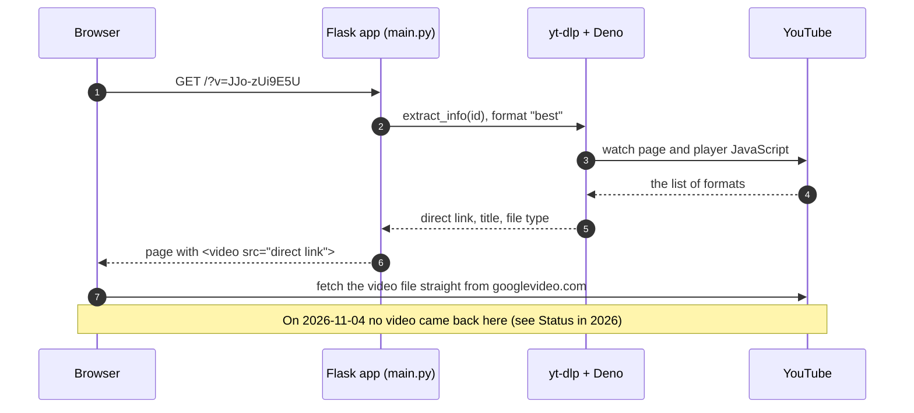

<p align="center">
  <picture>
    <source media="(prefers-color-scheme: dark)" srcset="https://raw.githubusercontent.com/NatLee/youtube-video-redirector/main/docs/images/hero-dark.png">
    
  </picture>
</p>

<p align="center">
  <a href="https://github.com/NatLee/youtube-video-redirector/actions/workflows/ci.yml"></a>
  
  <a href="LICENSE"></a>
</p>

> There's a newer project for this: [streaming-player](https://github.com/NatLee/streaming-player).

YouTube Video Redirector is a tiny Flask app with one trick. Put a YouTube video ID in the address
bar, `/?v=JJo-zUi9E5U`, and it asks [yt-dlp](https://github.com/yt-dlp/yt-dlp) for the video's
direct file link: the actual `googlevideo.com` address of the MP4, not the watch page. The page shows
you that link and plays it in a plain [Video.js](https://videojs.com/) player. No watch page, no
embed, just the file.

## What it solved

Back in 2021 the question was simple: where does a YouTube video actually live? Behind every watch
page there is a plain video file on Google's servers, and yt-dlp's predecessor youtube-dl knew how to
find it. The idea came from [zdwolfe/yt-redirector](https://github.com/zdwolfe/yt-redirector), and the
very first commit here did exactly that: `/?v=<id>` answered with an HTTP redirect to the file.
Twenty minutes later the redirect became a page that shows the link and plays it, which is the shape
it kept.

## How it works



The whole app is [`main.py`](main.py) and one template. `format: "best"` picks the best format that
already has video and sound in one file, because a plain `<video>` tag can't merge separate streams.
Deno is in the picture because YouTube now hands out its formats only after its player JavaScript has
run, and yt-dlp needs a JavaScript runtime to run it.

## Run it

### With Docker

```bash
git clone https://github.com/NatLee/youtube-video-redirector.git
cd youtube-video-redirector
docker build -t youtube-video-redirector .
docker run --rm -p 5000:5000 youtube-video-redirector
```

Or in one line, straight from GitHub without cloning:

```bash
docker run --rm -p 5000:5000 $(docker build -q https://github.com/NatLee/youtube-video-redirector.git)
```

Then open <http://localhost:5000/>, paste a video ID or link, and press Play. The image runs gunicorn
(a production web server) as a non-root user.

### Without Docker

You need Python 3.11 or newer (tested with 3.12).

```bash
python -m venv .venv
source .venv/bin/activate        # Windows: .venv\Scripts\activate
pip install -r requirements.txt
python main.py
```

That starts Flask's development server on `0.0.0.0:5000` with debug on, as it always did. Port 5000
taken (macOS uses it for AirPlay)? Run `PORT=5001 python main.py`.

### Tests

```bash
docker build --target test .
```

That runs the pytest suite inside the same image the app ships in, so you don't need Python on your
machine. yt-dlp is faked in the tests; nothing talks to YouTube. CI runs the same build, then starts
the container and checks that it answers.

## Status in 2026: what still works

Checked on 2026-11-04 with this version in Docker and a headless Edge browser:

- **yt-dlp found the link.** `/?v=JJo-zUi9E5U` came back with the right title and a
  `googlevideo.com` direct link (the 360p MP4) in about four seconds.
- **YouTube did not stream that link to the browser.** The player shows "The media could not be
  loaded". Edge blocks the reply as `ERR_BLOCKED_BY_ORB`, which means YouTube answered with something
  other than video. Fetching the file is exactly the step this app was built around, so for
  YouTube this is where the trick stops.
- **YouTube also rations the links.** After about fifteen lookups in forty minutes from the same
  machine, it answered "Sign in to confirm you're not a bot" instead, and the page showed that
  message (with HTTP 502) rather than falling over. Half an hour later the links came back.
- **The rest of the trick still works with other sites yt-dlp knows.** Give it a Wikimedia Commons
  file page and it finds the WebM and plays it, as in the screenshot below.

When YouTube changes how it hands out formats, a newer yt-dlp is usually the fix: bump the
`yt-dlp[default,deno]` line in [`requirements.txt`](requirements.txt) to the latest release and
rebuild.

## Then and now

<p align="center">
  <picture>
    <source media="(prefers-color-scheme: dark)" srcset="https://raw.githubusercontent.com/NatLee/youtube-video-redirector/main/docs/images/screenshot-dark.png">
    
  </picture>
</p>
<p align="center"><sub>Today's version, running in Docker, playing a Wikimedia Commons link (YouTube's own links no longer play in a browser, see above).<br>Big Buck Bunny © Blender Foundation, <a href="https://creativecommons.org/licenses/by/3.0/">CC BY 3.0</a>.</sub></p>

<p align="center">
  
</p>
<p align="center"><sub>The page as it shipped in 2021: the raw link, printed in full, above the player.</sub></p>

## Credits

- The idea comes from [zdwolfe/yt-redirector](https://github.com/zdwolfe/yt-redirector).
- [yt-dlp](https://github.com/yt-dlp/yt-dlp) does all the hard work, and youtube-dl did it before that.

## License

[MIT](LICENSE)
